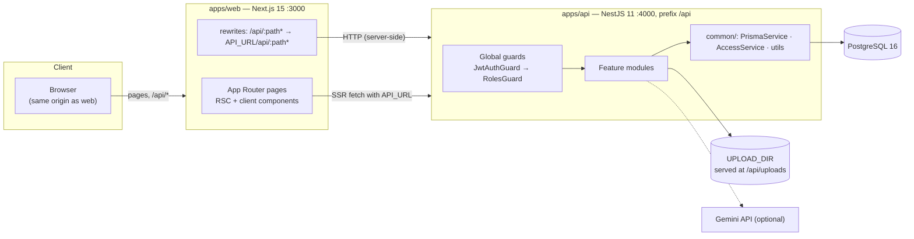
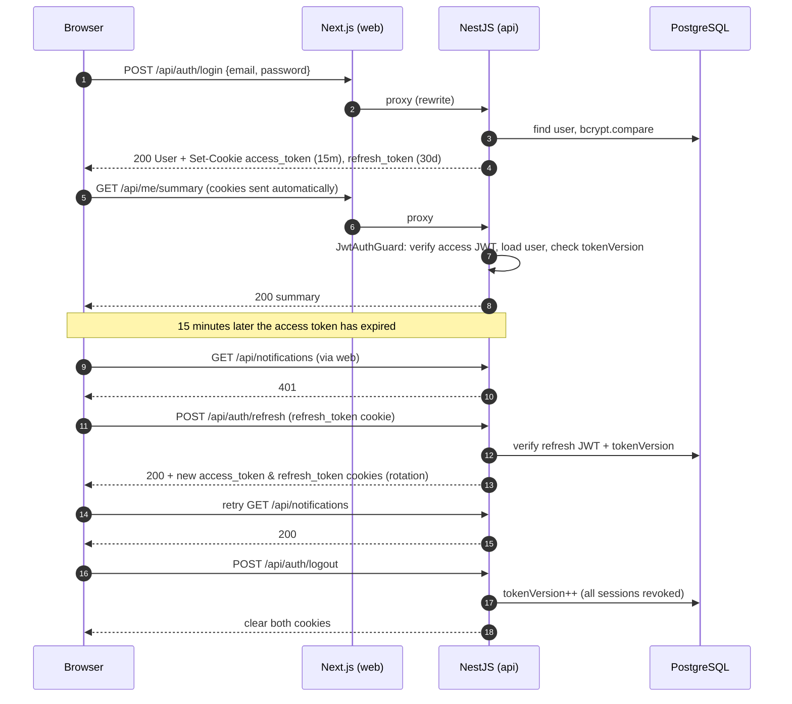
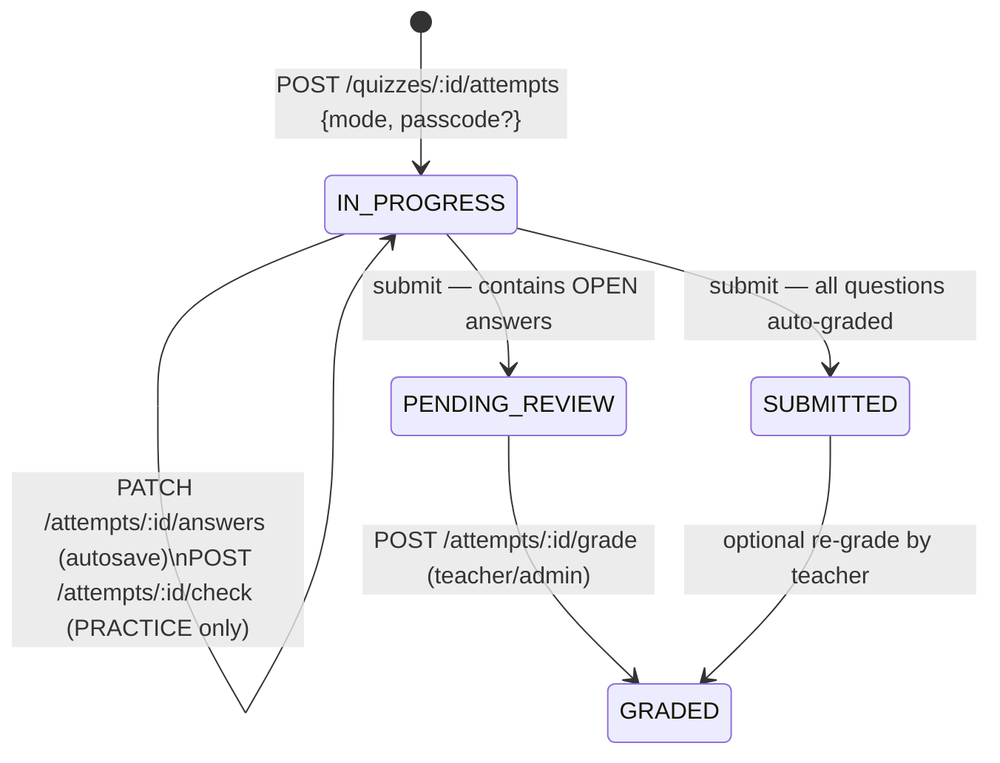
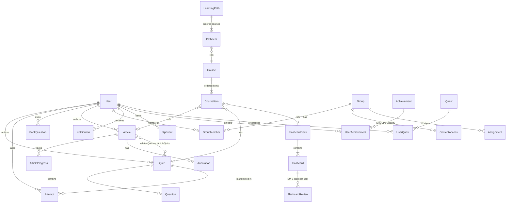

# Eduventure 2.0 — Architecture

This document explains how the pieces fit together. The contract (routes, models, payloads) lives in [SPEC.md](SPEC.md); this file explains the *why* and the non-obvious rules. Deployment is covered in [DEPLOY.md](DEPLOY.md).

- [1. System overview](#1-system-overview)
- [2. Backend modules](#2-backend-modules)
- [3. Auth flow (cookies + refresh)](#3-auth-flow-cookies--refresh)
- [4. Quiz attempts and the grading engine](#4-quiz-attempts-and-the-grading-engine)
- [5. Gamification rules](#5-gamification-rules)
- [6. Visibility model](#6-visibility-model)
- [7. Flashcards — SM-2](#7-flashcards--sm-2)
- [8. Frontend](#8-frontend)
- [9. Data model](#9-data-model)
- [10. Operations](#10-operations)

---

## 1. System overview



Key decisions:

| Decision | Reason |
|---|---|
| Browser only talks to the web origin; Next.js proxies `/api/*` | Auth cookies are first-party (`SameSite=Lax`), no CORS preflights, no cross-site cookie problems on Safari. |
| Two independent npm projects (`apps/api`, `apps/web`), no workspaces | Each app has its own lockfile, Docker build context and deploy target (Vercel vs container host). |
| Prisma migrations committed in `apps/api/prisma/migrations` | `prisma migrate deploy` on container start is deterministic and safe with several instances (advisory lock). |
| Domain logic in pure functions (`question-engine.ts`, `sm2.ts`, level maths) | Easy to unit-test, shared by quizzes / attempts / practice / bank / ai. |

## 2. Backend modules

Every feature lives in `apps/api/src/modules/<name>/` (`*.module.ts`, `*.controller.ts`, `*.service.ts`, `dto/`). Cross-cutting code is in `src/common/`.

| Module | Responsibility | Main routes |
|---|---|---|
| `auth` | register/login/refresh/logout, cookie issuing, token versioning | `/auth/*` |
| `users` | profile (`/me`), password change, summary dashboard, public profiles, role management | `/me*`, `/users*` |
| `quizzes` | CRUD, question normalisation, clone, CSV import, categories | `/quizzes*` |
| `attempts` | start / autosave / practice check / submit / manual grading | `/quizzes/:id/attempts`, `/attempts*` |
| `practice` | weak-topic analysis, virtual "smart practice" quiz | `/practice/*` |
| `bank` | reusable question bank, CSV import, copy to quiz | `/bank*` |
| `ai` | question generation (Gemini or deterministic mock) | `/ai/generate-questions` |
| `stats` | teacher/admin analytics (overview, per quiz, student, group) | `/stats/*` |
| `gamification` | XP, levels, streaks, achievements, quests, leaderboards | `/leaderboard`, `/achievements`, `/quests*`, `/admin/quests*`, `/admin/achievements*` |
| `notifications` | in-app notifications; `NotificationsService.notify()` used by everyone | `/notifications*` |
| `uploads` | image upload (≤ 5 MB) to `UPLOAD_DIR`, served statically | `/uploads`, `/api/uploads/...` |
| `articles` | markdown articles, reading progress, annotations | `/articles*`, `/annotations/:id` |
| `courses` / `paths` | ordered items (article/quiz/deck) and ordered courses | `/courses*`, `/paths*` |
| `decks` | flashcard decks, study queue, SM-2 reviews | `/decks*`, `/flashcards/:id/review` |
| `groups` / `assignments` | classes, membership, assigning content with due dates | `/groups*`, `/assignments*` |
| `comments` / `bookmarks` | threaded comments, bookmarks on any content | `/comments*`, `/bookmarks*` |
| `content` | visibility changes, passcode unlock, admin permissions view | `/content/*` |
| `search` | global search (max 5 per type, visibility-aware) | `/search` |
| `health` | liveness probe (public) | `/health` |

`src/common/` provides:

- `PrismaService` (global) — one Prisma client per process.
- `JwtAuthGuard` (global `APP_GUARD`) — every route requires a valid access token unless decorated with `@Public()`; on public routes the user is still parsed when a token is present.
- `RolesGuard` (global) — enforces `@Roles('TEACHER', 'ADMIN')`; **ADMIN always passes**.
- `@CurrentUser()` / `@CurrentUser('id')` — the authenticated `AuthUser {id, email, name, role}`.
- `AccessService` (global) — the visibility model ([§6](#6-visibility-model)).
- Utilities: `slugify`, `shuffle`, `publicUser` (strips `passwordHash`/`tokenVersion`), `dayKey`/`weekKey` (Baku time, UTC+4).

Validation: a global `ValidationPipe({ whitelist: true, transform: true })` with class-validator DTOs; errors use Nest's default `{statusCode, message}` with Azerbaijani messages.

## 3. Auth flow (cookies + refresh)

- Passwords: `bcryptjs`, cost 10.
- Tokens: two JWTs with payload `{ sub: userId, tv: tokenVersion }`.
  - `access_token` — 15 min, signed with `JWT_ACCESS_SECRET`.
  - `refresh_token` — 30 days, signed with `JWT_REFRESH_SECRET`.
- Both are set as cookies: `httpOnly`, `SameSite=Lax`, `Path=/`, `Secure` when `NODE_ENV=production` (unless `COOKIE_SECURE=false`). The API also accepts `Authorization: Bearer <access>` for scripts/tests.
- **Revocation:** every request re-reads the user and compares `tokenVersion` with the token's `tv`. `POST /auth/logout` increments `tokenVersion`, which immediately invalidates all access *and* refresh tokens of that user on every device.



Client side (`apps/web/src/lib/api.ts`): `credentials: 'include'`, on a `401` it calls `POST /api/auth/refresh` **once** and retries the original request; if refresh fails the user is treated as logged out. `useAuth()` exposes `{ user, isLoading, login, register, logout, refetch }` and `<RequireRole>` gates Studio/Admin screens (the API enforces roles independently).

Authenticated data is fetched from client components (TanStack Query) through the same-origin `/api` proxy; code running on the server uses `API_URL` directly.

## 4. Quiz attempts and the grading engine

### Attempt lifecycle



- **Start:** checks visibility/passcode, reuses an existing `IN_PROGRESS` attempt for the same quiz+mode, enforces `maxAttempts` for EXAM mode (authors/admins are exempt), fixes the question order (`questionOrder`, shuffled when `shuffleQuestions`). Students receive *sanitized* questions — no `correct`, no `explanation`.
- **Timer:** `timeLimitSec` is enforced server-side with a 60 s grace period; `timeSpentSec` is clamped to the real elapsed time and to the limit.
- **Submit** is idempotent (a timer auto-submit racing a click returns the already graded attempt and 0 XP).
- **Review:** correct answers/explanations are revealed after submission when `showAnswers` is on, always in PRACTICE mode, and always to the author/staff.
- **Manual grading:** teachers assign points per question (clamped to `0..max`); ungraded OPEN answers count as 0; status becomes `GRADED`, the student gets a notification, and an EXAM attempt receives an XP top-up if the reviewed score is higher than the provisional one.

### Grading engine — `apps/api/src/modules/quizzes/question-engine.ts`

Pure functions shared by quizzes, attempts, practice, bank and ai:

| Function | Purpose |
|---|---|
| `normalizeQuestion()` | Validates and coerces author input (incl. legacy type names and `___` blanks) into the canonical `correct` shapes from SPEC §2. |
| `viewQuestion()` | The question *as seen inside one attempt*: options are permuted with a deterministic seed `attemptId:questionId` (mulberry32), and `correct` is remapped into that index space. Answers are stored and graded in view-index space, so reloading an attempt shows the same order. ORDERING items are always shuffled (never the identity). |
| `sanitizeQuestion()` | Strips `correct`, `explanation`, `correctOrder`. |
| `gradeQuestion()` | Grades one answer → `{correct: boolean \| null, points, max}`. |
| `summarize()` | `score`, `maxScore`, `percent` (2 decimals), `passed = percent ≥ passPercent`, `pending` if any OPEN answer awaits review. |

Rules per type:

| Type | Answer | Correct when | Points |
|---|---|---|---|
| `SINGLE` | `number` (index; option text also accepted) | index matches | all or nothing |
| `MULTIPLE` | `number[]` | exactly the same set | all or nothing |
| `TEXT` | `string` | matches any accepted variant after normalisation | all or nothing |
| `TRUE_FALSE` | `boolean` (also "doğru"/"yanlış", "true"/"false", 1/0) | equals `value` | all or nothing |
| `ORDERING` | `string[]` items (or view indices) | same order as the authored order | all or nothing |
| `FILL_BLANKS` | `string[]` per `{{n}}` | each blank matches one of its variants | **partial**: `points × correctBlanks / blanks` |
| `OPEN` | `string` | — | `correct: null` → manual review; empty answer = wrong |

Text normalisation (`normText` + contraction expansion): Unicode NFKC, curly quotes/dashes unified, case-insensitive (locale-independent), whitespace collapsed, leading/trailing punctuation ignored, and English contractions expanded (`can't` = `cannot` = `can not`, `I'm` = `I am`, `won't` = `will not`, …). Variants can be authored as `go|goes` or `go / goes`.

**Smart practice** (`/practice/smart`): weak topics are computed from the user's graded answers aggregated by question `tags` (accuracy = correct / total, weakest first). A virtual PRACTICE quiz is assembled from previously missed questions and topped up with questions from visible quizzes on the requested/weakest tags (1–30 questions).

## 5. Gamification rules

All XP flows through `GamificationService.onEvent(userId, event)` (or `awardXp` for ad-hoc grants). Every grant writes an `XpEvent` row — leaderboards for *week / month / all* are sums of `XpEvent.amount` over the period (optionally restricted to a group's members).

| Event | XP |
|---|---|
| Quiz submitted — EXAM | `round(percent / 10) + 5` (5–15) |
| Quiz submitted — PRACTICE | `3` |
| Perfect score (100 %) | `+20` |
| Article completed | `10` |
| Course completed | `50` |
| Flashcard reviewed | `1` per card |
| Achievement unlocked | `achievement.xpReward` |
| Quest claimed | `quest.xpReward` |
| Manual review raised the score | difference of `round(percent/10)` (+20 if it became perfect) |

**Levels:** `level = floor(sqrt(xp / 100)) + 1`; XP needed for level *L* is `100 × (L − 1)²`.

| Level | 1 | 2 | 3 | 4 | 5 | 10 |
|---|---|---|---|---|---|---|
| Total XP | 0 | 100 | 400 | 900 | 1 600 | 8 100 |

`/me/summary` returns `levelProgress` (0–1) between the current and next level and `nextLevelXp`. A level-up creates a `LEVEL_UP` notification.

**Streak:** days are Baku calendar days (UTC+4). Any learning event updates `lastActiveAt`; activity on the next day increments `streak`, a gap of more than one day resets it to 1. The displayed streak is 0 when the last activity was before yesterday.

**Quests** (`Quest {type, target, xpReward, period}`): types `COMPLETE_QUIZZES`, `READ_ARTICLES`, `STUDY_CARDS`, `PERFECT_SCORE`, `EARN_XP`. Progress is tracked per `UserQuest(userId, questId, periodKey)` where `periodKey` is the day (`DAILY`), ISO week (`WEEKLY`) or `once`. Completion notifies the user; the reward is granted on `POST /quests/:id/claim` (quest XP does not count towards `EARN_XP` quests).

**Achievements** (`Achievement.rule` JSON): `{type:'quizzes'|'passed'|'perfect'|'practice'|'articles'|'courses'|'cards', count}`, `{type:'streak', days}`, `{type:'xp', amount}`, `{type:'level', level}`. They are evaluated after every event (two passes, because an achievement's XP reward can satisfy an `xp`/`level` rule), unlocked once per user, rewarded with `xpReward`, and announced via notification and in the submit response (`newAchievements`).

## 6. Visibility model

Content types: `QUIZ`, `ARTICLE`, `COURSE`, `PATH`, `DECK`. Each has `status` (`DRAFT | PUBLISHED | ARCHIVED`), `visibility` and optional `passcode`. All checks go through `AccessService` (`apps/api/src/common/access/access.service.ts`).

| Visibility | Anonymous | Student | Teacher | Author / Admin |
|---|---|---|---|---|
| `PUBLIC` | ✅ | ✅ | ✅ | ✅ |
| `PRIVATE` | ❌ | ❌ | ❌ | ✅ |
| `GROUPS` | ❌ | ✅ if a group they belong to is linked via `ContentAccess` | ✅ | ✅ |
| `PASSCODE` | listed, 🔒 locked | listed, 🔒 until unlocked | ✅ | ✅ |

- Non-authors only ever see `PUBLISHED` content; authors and admins also see drafts.
- **Listing vs viewing:** `access.listWhere(user, type)` returns a Prisma `where` fragment for lists (PRIVATE and foreign GROUPS items are hidden, PASSCODE items are listed with a lock). `access.assertCanView()` guards detail routes: hidden content returns **404** (no information leak), locked content returns **403 `{locked: true}`** so the UI can ask for the passcode.
- **Unlocking:** `POST /content/:type/:id/unlock {passcode}` (or `passcode` in the start-attempt body) — a correct passcode is remembered per user in `ContentUnlock`, so it is asked only once.
- `PATCH /content/:type/:id/visibility {visibility, passcode?, groupIds?}` (author/admin) rewrites `ContentAccess` rows for `GROUPS`. Admins see everything on `/admin/permissions` (`GET /content/permissions`).
- Assignments, search, bookmarks, courses and paths reuse the same rules when they summarise nested content.

## 7. Flashcards — SM-2

Implementation: `apps/api/src/modules/decks/sm2.ts` (same maths as the legacy study page). State per user and card: `FlashcardReview {ease = 2.5, interval = 0 (days), repetitions = 0, dueAt, lastGrade}`.

Buttons map to SM-2 quality *q*: **Again 0 → q0**, **Hard 1 → q2**, **Good 2 → q4**, **Easy 3 → q5**.

```
if q < 3:                       # Again / Hard
    repetitions = 0
    interval    = 0 (Again → due again in 10 minutes) | 1 day (Hard)
else:                           # Good / Easy
    interval = 1        if repetitions == 0
             = 6        if repetitions == 1
             = round(interval × ease) otherwise
    repetitions += 1
ease = max(1.3, ease + 0.1 − (5 − q) × (0.08 + (5 − q) × 0.02))
dueAt = now + interval days
```

The study queue (`GET /decks/:id/study`) returns due cards (oldest `dueAt` first) followed by never-seen cards in deck order, at most **20** per session. Each review awards 1 XP and advances `STUDY_CARDS` quests; `cardsDue` on the dashboard counts reviews with `dueAt ≤ now`.

## 8. Frontend

- **Next.js 15 App Router**, TypeScript, Tailwind CSS v4 (`@theme` tokens in `src/app/globals.css`), `motion` for animation, TanStack Query v5 for server state, `lucide-react` icons. Fonts are bundled via `@fontsource` (no network at build time).
- **Route groups:** `(marketing)` landing · `(auth)` login/register · `(app)` the shell (left rail / mobile tab bar, ⌘K palette, streak, XP chip, notifications) · `(focus)` distraction-free quiz taking and flashcard study. Full route map: [SPEC.md §1](SPEC.md).
- **Layers:**
  - `src/components/ui` — design-system primitives (Button, Card, Modal, Tabs, Table, …) and `toast`.
  - `src/components/motion` — Reveal, Stagger, NumberTicker, TopoBackground, TrailPath, confetti, …
  - `src/components/shell` — app chrome.
  - `src/lib` — `api` client (refresh-once logic), `auth` (`useAuth`, `RequireRole`), shared domain `types`, `cn()`.
  - `src/features/{quiz,learn,community,admin}` — screens, components and TanStack Query hooks per domain.
- **Theming:** dark "Night Expedition" by default (`data-theme="dark"`), light "paper map" theme; all colours are CSS variables. Motion respects `prefers-reduced-motion`.

## 9. Data model

Simplified (see `apps/api/prisma/schema.prisma` for every field):



Polymorphic references (`ContentAccess`, `Assignment`, `Bookmark`, `Comment`, `ContentUnlock`) use `(contentType | targetType, contentId | targetId)` instead of foreign keys.

## 10. Operations

- **Containers:** `apps/api/Dockerfile` (Debian slim + OpenSSL for Prisma, `tini`, prod deps only, Prisma CLI + tsx pinned from the lockfile for migrations/seed) and `apps/web/Dockerfile` (Alpine; uses Next.js `output: 'standalone'` when enabled, otherwise a pruned `next start` bundle). The API entrypoint fixes the uploads volume ownership, drops to the `node` user, runs `prisma migrate deploy` (or `db push` if no migrations exist), optionally seeds (`SEED_ON_START=true`) and starts `node dist/main`.
- **Health:** `GET /api/health` (public) → `{ ok: true }`; used by Docker healthchecks and PaaS probes.
- **CI** (`.github/workflows/ci.yml`): API — `npm ci`, `prisma validate/generate`, `tsc`, build, migrate against a Postgres 16 service, migration-drift check, seed, tests (if present), boot + demo-admin login smoke test. Web — `npm ci`, `next typegen`, `tsc`, lint (if configured), build. Docker — build both images, start the full compose stack, log in through the web proxy.
- **Dependabot:** weekly npm updates per app (grouped), monthly GitHub Actions and Docker base images.
